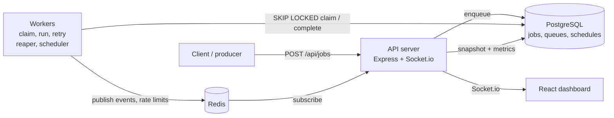

# Relay

Distributed background job queue and worker engine built with **TypeScript, PostgreSQL, Redis and Docker**.
Jobs are claimed exactly once with `SELECT ... FOR UPDATE SKIP LOCKED`, retried with backoff, recovered after worker crashes, and watched live on a dashboard.

**Live demo:** `https://relay-omega-ten.vercel.app/` · **API health:** `https://relay-6nuz.onrender.com/api/health`
*(Free tier: the first request after idle can take about 30 s to wake.)*


## Features

- **Atomic job claiming:** no job is claimed by two workers, with no external lock service
- **Retries:** exponential backoff with jitter (capped at 5 min), then a `failed` dead-letter state
- **Crash recovery:** heartbeats plus a reaper requeue jobs from dead workers; ownership fencing stops stale workers from overwriting a reclaimed job
- **Cron schedules:** timezone-aware, fire once on missed runs
- **Rate limiting:** Redis token bucket (atomic Lua) shared by all workers
- **Live dashboard:** Redis pub/sub, Socket.io, React and Tailwind, with throughput and p50/p95 metrics
- **Operations:** graceful shutdown, Zod-validated config, structured pino logs

## Architecture



Postgres is the source of truth. Redis carries only live events and rate-limit buckets.

## Tech stack

TypeScript, Node.js, Express, PostgreSQL (`pg`), Redis (ioredis), Socket.io, React, Tailwind CSS, Docker Compose, Jest, autocannon.

## Run locally

```bash
cp .env.example .env
docker compose up --build
# API: http://localhost:3000    Dashboard: http://localhost:5173
```

Enqueue a job:

```bash
curl -X POST http://localhost:3000/api/jobs \
  -H "x-api-key: $API_KEY" -H "content-type: application/json" \
  -d '{"queue":"emails","payload":{"to":"a@b.com"}}'
```

Run tests: `npm test` (Jest against a separate `relay_test` database).

## How it works

1. **Claim:** one `UPDATE ... WHERE id = (SELECT id FROM jobs WHERE status='pending' AND run_at <= now() ORDER BY run_at FOR UPDATE SKIP LOCKED LIMIT 1) RETURNING *`. Locked rows are skipped, so workers spread across different jobs.
2. **Retry:** a failed job returns to `pending` with `run_at = now() + backoff`; after `max_attempts` it becomes `failed`.
3. **Recovery:** workers refresh `locked_at` while running; the reaper requeues jobs whose lock went stale and counts the attempt.
4. **Fencing:** completion and heartbeat updates require `locked_by` and `status='processing'`.
5. **Live updates:** workers publish events after commit; the API batches them (100 ms) and emits over Socket.io; the dashboard loads a snapshot first.

Guarantees: claiming is exactly-once; execution is at-least-once, so handlers should be idempotent.

## Testing and results

All numbers below were measured on a single local machine with [autocannon](https://github.com/mcollina/autocannon) against the local Docker Compose stack. Machine: `CPU: Intel Core i3-1005G1 (10th Gen, 2 Cores / 4 Threads) / RAM: 8 GB DDR4 (2667 MT/s)`.

### Correctness

| Test | Setup | Result |
| --- | --- | --- |
| Automated tests | Jest, `--runInBand` | 33 passing, 6 suites |
| Index usage | 100,000 jobs seeded, workers stopped, `EXPLAIN` on the claim query | Partial index `idx_jobs_claim` used |
| Fault tolerance | 1,000 jobs, 4 workers, one worker stopped mid-run | All 1,000 completed, 0 failed, **0 duplicate executions** (checked via `job_executions`) |

### Poll interval: 1000 ms vs 100 ms

1,000 jobs, queue wait time (enqueue to claim):

| Percentile | 1000 ms poll | 100 ms poll | Change |
| --- | --- | --- | --- |
| p50 | 537 ms | 77 ms | 86% lower |
| p99 | 3,476 ms | 1,752 ms | 50% lower |

Shorter polling cuts pickup latency at the cost of more idle queries against Postgres. `LISTEN/NOTIFY` wake-ups are the planned next step.

### Paced load: end-to-end latency

4 workers, concurrency 1 each, jobs submitted at a fixed rate:

| Rate | p50 | p95 | p99 |
| --- | --- | --- | --- |
| 30 jobs/s | 358 ms | 937 ms | 1,028 ms |
| 70 jobs/s | 2,364 ms | 2,849 ms | 2,937 ms |
| 120 jobs/s | 24,321 ms | 47,791 ms | 50,779 ms |

Latency stays under about 1 s at 30 jobs/s, rises to about 2.4 s at 70 jobs/s as the workers near capacity, and grows without bound at 120 jobs/s because arrivals exceed the processing rate and the backlog builds.

### Burst throughput

20,000 jobs enqueued at once:

| Workers | Throughput |
| --- | --- |
| 1 | 107 jobs/s |
| 2 | 101 jobs/s |
| 4 | 149 jobs/s |
| 8 | 175 jobs/s |

Adding workers helps but sub-linearly (8 workers give about 1.6x one worker). Every worker and the API share one machine and one Postgres instance here, so this reflects database and CPU contention on a laptop rather than a limit of the design. See the scaling notes below.

## Trade-offs and limits

- At-least-once execution: a worker that crashes after finishing but before marking complete causes a rerun.
- Polling costs queries and adds up to one poll interval of latency.
- Every state change writes to one `jobs` table, so throughput is bounded by a single Postgres primary.
- Completed jobs accumulate without a retention job.
- Redis events are at-most-once; the dashboard recovers by reloading a snapshot.
- The Socket.io feed is unauthenticated and there is a single shared API key.

## Scaling and next steps

- More workers and tuned connection pools first; batch claims (`LIMIT n`) to cut round trips.
- `LISTEN/NOTIFY` wake-ups instead of idle polling.
- Retention job and time-partitioned `jobs` table.
- Idempotency keys on enqueue, job priorities, authenticated sockets.

## Deployment (free tier)

| Part | Host |
| --- | --- |
| Dashboard | Vercel |
| API + embedded worker (`EMBED_WORKER=true`) | Render |
| PostgreSQL | Neon |
| Redis | Upstash |

## Project structure

```
src/
  server.ts, worker.ts, config.ts, db.ts, migrate.ts
  workers/      claim, complete, reaper, backoff
  scheduler/    cron + scheduler
  ratelimit/    token bucket + gate
  events/       Redis pub/sub
  repositories/ jobs, queues, metrics
  routes/       jobs, schedules, queues, metrics, health
dashboard/      React + Tailwind
sql/migrations/ ordered, checksummed migrations
```

## License

MIT
